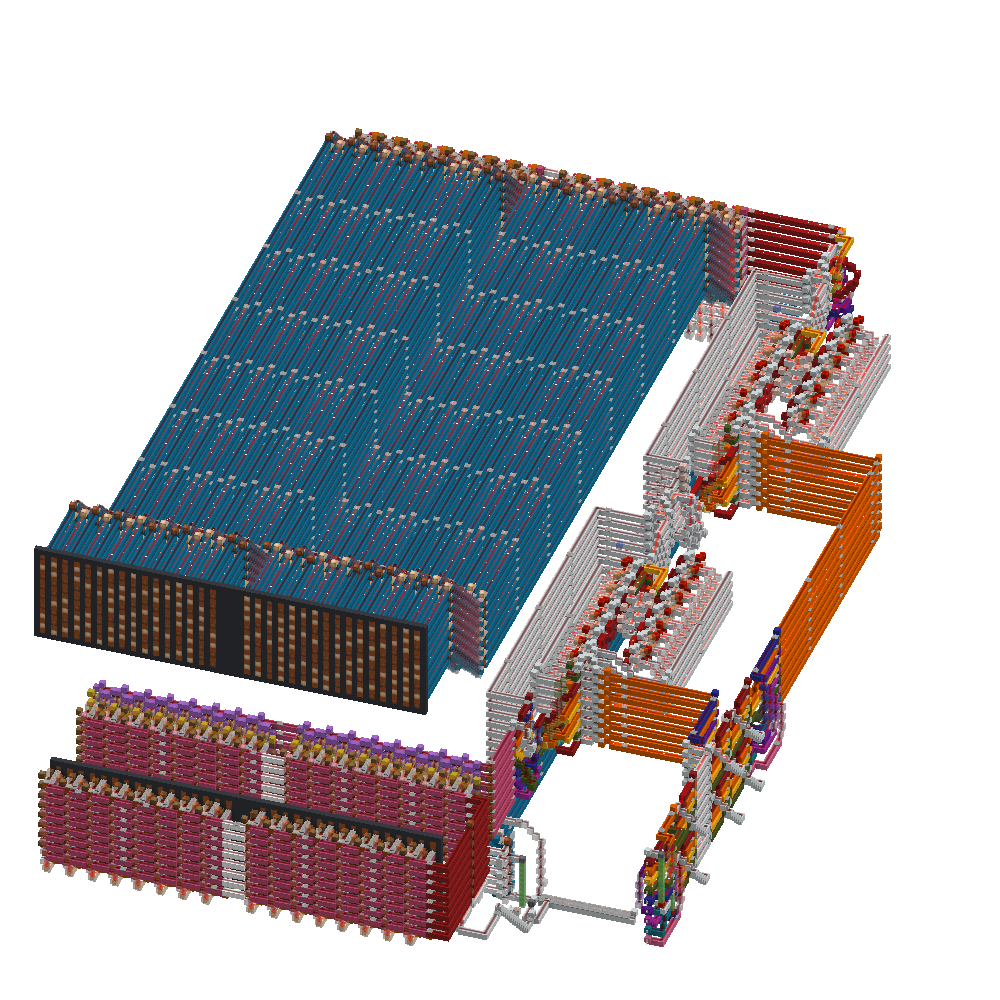

This is a minecraft redstone circuit that implements [Simplified DES](https://www.math.umd.edu/~immortal/ClassNotes/simplifieddes.pdf) that me and my friend [xiberxia](https://github.com/xiberxia/) built for a CTF challenge. It applies sdes to each byte of a 32 byte ram bank and displays the output.

[dist.zip](./dist.zip) contains only the circuit
[dev.zip](./dev.zip) contains a development world

these worlds are for minecraft version 26.2

i'm not completely sure that this circuit is correct, but it works for encrypting the flag we used

would recommend speeding up the tick rate because each cycle is configured to take around (50?) redstone ticks

#

version 2.0 I have some things I want to change

- move output RAM bank closer to output display instead of having a cursed 32 byte bus (blue lines)
- wire permutation design is inoptimal, and can probably be automated
- explore alternate more compact rom bank designs
- unit test the cipher by testing and comparing all 256 inputs for a given key against [fiestal.py](./fiestal.py)
    - (i have something wip where I launch a mc server and automatically load a schematic w/inputs a bunch of times)
